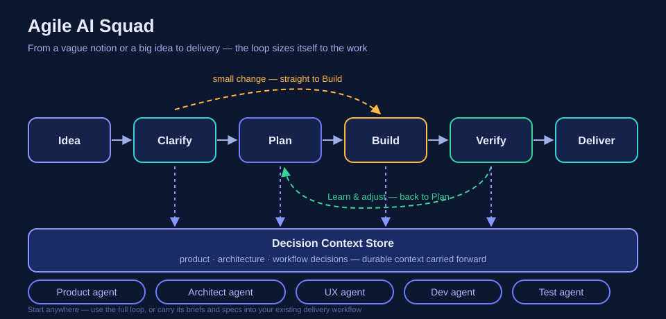
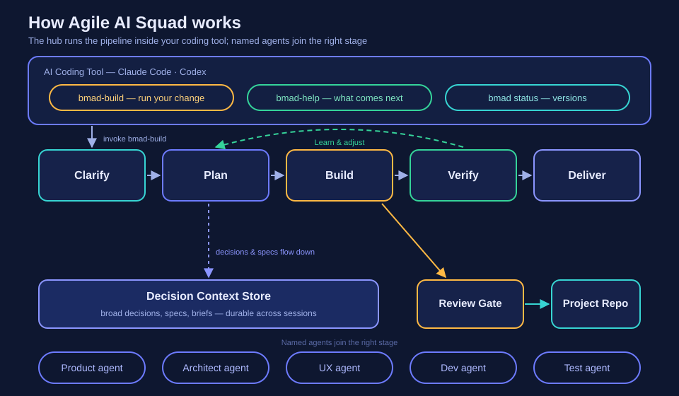

# Agile AI Squad
**A squad of specialized AI agents that plans, builds, verifies, and learns for you — the agile way to turn an idea or change request into working software.**

[download-url]: https://github.com/bmad-code-org/BMAD-METHOD

     

[][download-url]

## Why

Modern coding assistants type fast — and just as happily turn your unstated assumptions into code, then forget them one chat later. Meanwhile every idea, even a one-line fix, gets pushed through the same heavyweight ritual of planning documents, because the process never sizes itself to the work.

Agile AI Squad brings the agile way of AI-driven development into your project: the effort is right-sized from the start, the important decisions are made explicit by the agents and stored as durable context, and every stage — clarify, plan, build, verify, learn — keeps you in control instead of handing over your judgment. The payoff: you spend your thinking where it changes the outcome, and the software answers to your decisions, not to an AI guess.

## Without / With

| Without Agile AI Squad | With Agile AI Squad |
| --- | --- |
| Hidden assumptions silently become code, and nobody remembers why | Every product and architecture decision is explicit and stored as reusable context |
| Every change pays for the same full planning bureaucracy | Small changes go straight to build; big initiatives get the depth they need |
| Context dies with the chat session, and each new day starts from zero | Product and technical context carries forward — the squad remembers for you |
| You are the whole team by yourself, from specs to QA | A squad of on-demand teammates: product, architecture, UX, development, testing |

## Quick Start

1. Click [Download][download-url] to get the agile-ai-squad package, and unpack it into a folder, for example `C:\dev\agile-ai-squad`.
2. Unblock the downloaded ZIP file before unpacking — right-click the file → Properties → Unblock — then unpack it into the folder. (For downloaded files, Unblock is required so Windows does not trip over the security mark.)
3. Install the Node.js runtime (once). Launch PowerShell → copy the command → paste it → press Enter. Run PowerShell as administrator so winget can install:
   `powershell winget install --id OpenJS.NodeJS.LTS -e`
4. Install dependencies and build the bot. Launch PowerShell → copy the command → paste it → press Enter, replacing `<full path to the folder>` with the folder from step 1:
   `powershell -NoProfile -Command "Set-Location '<full path to the folder>'; npm install; npm run build"`
5. Save your Telegram bot token (from @BotFather) and your Groq key (from console.groq.com) into a `.env` file, then start the bot. Launch PowerShell → copy the command → paste it → press Enter:
   `powershell -NoProfile -Command "Set-Location '<full path to the folder>'; Set-Content .env 'TELEGRAM_BOT_TOKEN=PUT_TOKEN_HERE','GROQ_API_KEY=PUT_KEY_HERE'; npm start"`

## Features

- Turn an idea or change request into working software without giving up the thinking.
- Keep every product and architecture decision explicit, durable, and reusable across sessions.
- Right-size the process: send small changes straight to build, and give large initiatives the depth they need.
- Bring in specialized perspectives on demand — product, architecture, UX, development, and testing.
- Start from nothing, or establish verified context on a codebase you inherited and work from what is actually there.
- Extend the method with official modules: builder, creative intelligence suite, enterprise test architecture, unattended epic loop, game dev studio.
- Learn continuously: reviewed implementation, correction, and retrospectives feed the next planning round.

## How it works

Inside your AI coding tool the `bmad` hub orchestrates the delivery pipeline — Clarify → Plan → Build → Verify → Deliver — summoning the named agents (Product, Architect, UX, Dev, Test) at the right stages; all decisions accumulate in the Decision Context Store, every change passes the Review Gate before it lands in the Project Repo, and the Learn step feeds the outcome back to Plan for the next round.

## Usage

- New prototype: run `npx bmad-method install` in your project, open your AI coding tool, and invoke `bmad-build` with what you want to change — `bmad-help` tells you what comes next.
- Legacy codebase: ask the `bmad` skill to establish verified context on an inherited codebase, then choose the planning path that fits your change.
- Unattended epic: install the loop module and let it build, verify, and retrospect a whole epic while you watch the report.

## Configuration

| Setting | Purpose | Notes |
| --- | --- | --- |
| Node.js 20.12+ | Runtime for the npm installer and the skills CLI | Required |
| Python 3.10+ and uv | Runs the method setup and its scripts | Install uv with the official installer |
| Coding tool | Target the skills install into (Claude Code, Codex, ...) | Asked during `npx skills add ... --skill '*'` |
| `bmad status` | Show installed versions and the recommended next step | Run it in your AI tool anytime |
| `bmad setup` | Apply updates: refresh skills, reconcile the project, clean up renamed entries | Runs `npx skills update` underneath |

## Troubleshooting / FAQ

- **The preview route changes too often for me.** Pin the stable route: `npx bmad-method install` (the stable release line) until the next major is finalized, so nothing breaks mid-week.
- **Which entry point do I invoke?** `bmad-build` to change something, `bmad` whenever you want guidance on what comes next or what is optional — the hub is the front door.
- **How do I check or roll updates?** Run `bmad status` for versions and the next step, then `bmad setup` to apply updates (or update through your tool's plugin marketplace first).
- **Setup scripts will not run.** Make sure Python 3.10+ and uv are on PATH — both routes need uv for the method setup and its scripts.
- **Found a preview bug.** Report it to the issue tracker of the upstream project or its community chat — feedback is part of the preview contract.

## Contributing

Contributions flow upstream to the open-source method behind this package: read its CONTRIBUTING.md before opening a pull request, report bugs and ideas through its issue tracker, or build your own workflows and expansion packs with the builder module and propose them to the community. This method is free for everyone and will stay that way — no paywalled workflows, no gated community. If the delivery loop unblocked your day, star the source repository from the Download page: even one star keeps the method alive.

## Keywords

bmad-method · agile · aidd · ai-driven · ai-agents · agentic-workflow · multi-agent · agent-skills · spec-driven-development · context-engineering · sdlc · product-management · prd · solution-architecture · user-stories · epics · retrospectives · planning-path · delivery-loop · review-gate · test-architect · software-testing · continuous-delivery · greenfield-project · legacy-codebase · prototyping · idea-to-software · change-request · decision-context · workflows · ai-coding-tools · claude-code · codex · nodejs · python · npm · open-source · mit-license · software-engineering · developer-tools · dev-workflow · code-review · automation · team-collaboration · expansion-modules · game-development · creative-intelligence · agile-methodology · scrum · status-tracking · software-delivery · technical-design · documentation · version-tracking · community-driven

## License

Released under the [MIT](./LICENSE) license.
